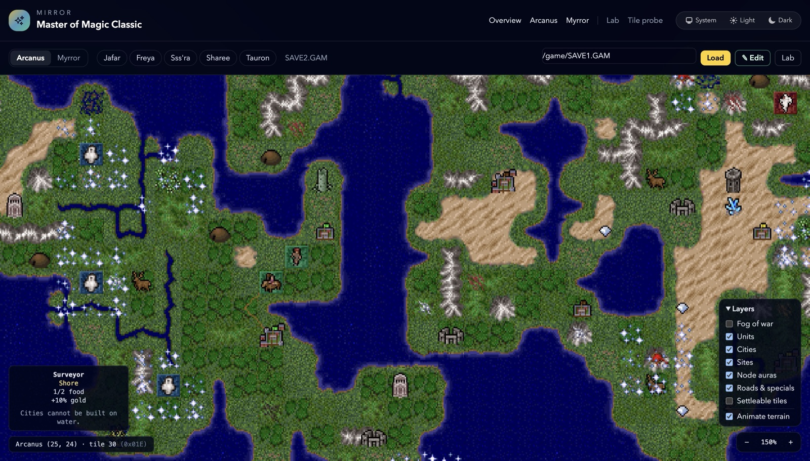
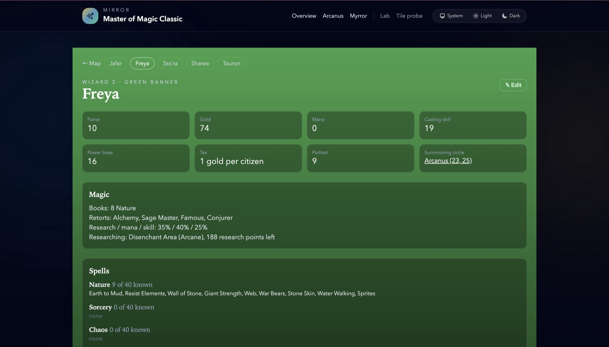

# Mirror

**Look inside your *Master of Magic* saves, and change them.**

Mirror opens a save file from the classic 1994 DOS game and shows you the whole world in your browser: both planes, every city, army, tower and lair, drawn with the game's own art. Then it lets you change things: reshape the land, move a city, give a wizard more gold, hand a hero a new sword. Save the result as a new file and load it in the game.





## What you can do

- **Explore the map.** Zoom and pan Arcanus and Myrror, hover any tile to see what it is, and switch layers on and off (units, cities, fog of war and more).
- **Edit the map.** Paint terrain, lay roads, move cities and armies, and open any city, lair or node to change what's in it. Undo and redo everything.
- **Edit the wizards.** Gold, mana, spell books, retorts, spells, relations, global enchantments, heroes and their artifacts.
- **Stay safe.** Mirror never overwrites the save you opened. **Save as** writes a new file, and you load that in the game.

Every kind of edit has been checked by loading the result in the real game.

## Get it running

You need **your own copy of the game**. Mirror can't include it. The GOG version works (Steam hasn't been tried). You also need [Elixir](https://elixir-lang.org/install.html) 1.20 with Erlang/OTP 29, or Docker.

```bash
git clone https://github.com/ApocryphaCipher/Mirror.git
cd Mirror
mix setup
mix mirror.import_game "/path/to/your/Master of Magic"   # a folder or a .zip
bash scripts/dev_server.sh
```

Open <http://localhost:4000/arcanus>, type the path of a save (for example `~/.mirror/game/SAVE1.GAM`) and press **Load**. Press Ctrl-C to stop.

The import step copies just the files Mirror needs, and your saves, into `~/.mirror/game`. It's safe to run again; it won't overwrite a save you've edited.

**Prefer Docker?**

```bash
docker compose up --build
```

That builds Mirror on your machine and serves it on port 4000, reading your game files from `~/.mirror/game`. To import them without Elixir installed:

```bash
docker compose run --rm -v "/path/to/install:/source:ro" app bin/mirror eval 'Mirror.GameFiles.import("/source", "/game")'
```

## Playing your edited save

**Save as** suggests the next free slot. The game only loads `SAVE1.GAM` to `SAVE9.GAM`, and its Load screen shows slots 1 to 8, so use one of those names, copy the file into your game folder, and load it as usual.

## Good to know

- Only the GOG 1.31 version of the game has been tested.
- Paint type keeps coasts and continents right. The raw tile tools (Cycle, Paint tile) don't, so use them with care.
- Time Stop can't be edited.

The full list is in the [release notes](docs/releases/v0.1.0.md).

## Under the hood

Mirror is a Phoenix LiveView app. The game's file formats are undocumented, so every format fact in the code was checked against the game itself, and the write-ups are in [docs/reference](docs/reference/). Project status, stories and session notes are in [docs/](docs/README.md).

## Contributing

Changes go through a pull request: branch, commit, open a PR, and CI must pass. The standards, for people and AI agents alike, are in [AGENTS.md](AGENTS.md). To run the tests:

```bash
mix test
```

## Licence

GPL-2.0, see [LICENSE](LICENSE). Parts of Mirror are ported from the GPLv2 MOMIME project, and the terrain table comes from [kazzmir/master-of-magic](https://github.com/kazzmir/master-of-magic). Details are in [NOTICE.md](NOTICE.md). The game's own files aren't included and aren't covered.

Mirror is maintained by [Kevin Asbury](https://github.com/KevinAsbury).
